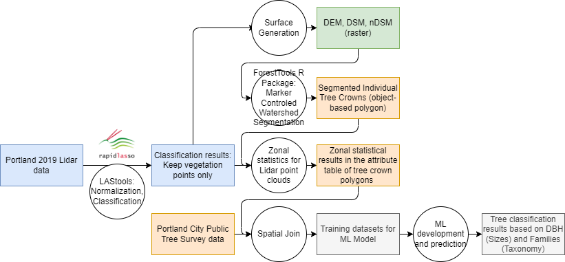

# Urban Tree Study with LiDAR

Code for the article:

> Yao, X., Kim, M., Dronova, I., McBride, J. R., Kondolf, G. M., & Radke, J. D. (2025). Community-scale microclimate simulation using Airborne Laser Scanning and object-based urban tree classification. *Landscape and Urban Planning, 263*, 105420. https://doi.org/10.1016/j.landurbplan.2025.105420

The study segments individual tree crowns from airborne LiDAR in two Portland, Oregon neighborhoods (Irvington, census tract 002401, "West"; Centennial, tract 009701, "East"), classifies trees by age/size group with machine learning, and uses the result to build ENVI-met microclimate simulations of current and alternative planting scenarios.



## Contents

| File | Step |
|---|---|
| `scripts/tree_crown_segmentation.R` | Treetop detection and crown delineation from a canopy height model (ForestTools, variable window filter + marker-controlled watershed) |
| `230105_Xihan_BandsCorrelation(pixel).ipynb` | City-scale pixel correlation of Landsat/NAIP indices, LST and social vulnerability |
| `230304TreePopulationData.ipynb` | Cleaning and preparing tree metrics for all segmented crowns |
| `230305TreeTrainingData.ipynb` | Building training samples from street and park tree inventories |
| `230306_MachineLearning_Classification_Regression.ipynb` | Comparing classifiers and predicting tree classes for the full population |
| `230318_clustering.ipynb` | Clustering, visualization and export of results |
| `230329_AlternativePlanting.ipynb` | Tree growth and alternative planting scenarios for ENVI-met |
| `230403_spatialCorrelation.ipynb` | Spatial correlation between tree metrics and simulated / observed temperature |

## Running

The notebooks were written in Google Colab and read inputs from a Google Drive folder (`/content/drive/MyDrive/XihanYAO_GISDataShare/`). To run them elsewhere, replace that path with your local data folder.

```bash
pip install -r requirements.txt
```

The R script needs `ForestTools`, `raster` and `rgdal`.

## Data

Raw airborne LiDAR (2019 Metro LiDAR acquisition) was provided by the City of Portland Bureau of Environmental Services under a project-specific data request and is not redistributed here; request it from the original provider. The street and park tree inventories are published by the City of Portland. Derived tree metrics, training data and ENVI-met model files are based on the restricted LiDAR and are available from the author on reasonable request.

## License

Code is released under the MIT License. If you use it, please cite the article above (see `CITATION.cff`).
